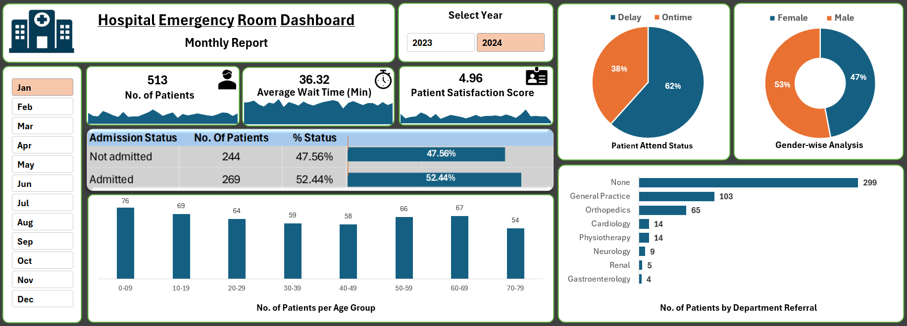

# Hospital Emergency Room Dashboard — Excel Project
An interactive Microsoft Excel dashboard designed to monitor emergency room performance, explore patient demographics, and uncover operational trends through data visualization.

## Project Overview

This project features an interactive Hospital Emergency Room Dashboard developed in Microsoft Excel to analyze patient visits and monitor key operational performance indicators.

The dashboard provides insights into patient volume, average waiting time, patient satisfaction, admission status, attendance status, gender distribution, age-group demographics, and department referrals.

With interactive year and month filters, users can explore patient visit patterns over time, identify operational trends, and support data-driven decision-making in hospital management.

## Objectives

- Analyze patient visit patterns and key performance indicators.
- Explore patient demographics and visit trends.
- Present key metrics through interactive charts and dashboard visuals.
- Demonstrate data cleaning, analysis, and reporting skills in Excel.

## Tools and Techniques

- Microsoft Excel
- Power Pivot, Pivot Tables, and Pivot Charts
- Slicers and interactive filters
- Power Query and DAX Query, where applicable
- Data visualization and dashboard design

## Dashboard Preview

## Key Insights

The following findings are based on the January 2024 dashboard view.

- Patient Volume: Analyzed 513 patient visits, with daily counts ranging from 10 to 25.
- Admission Analysis: 269 patients (52.44%) were admitted, while 244 (47.56%) were not admitted.
- Waiting Time: The reported average waiting time was 36.32 minutes.
- Patient Satisfaction: The reported average satisfaction score was 4.96.
- Attendance Status: 62% of visits were classified as delayed and 38% as on time.
- Demographic Analysis: The 0–9 age group had the highest displayed patient count (76), while the 70–79 age group had the lowest (54). The gender distribution was 53% male and 47% female.
- Department Referrals: The "None" category had 299 records, followed by General Practice (103) and Orthopedics (65).

## Skills Demonstrated

Data analysis, Excel reporting, Interactive Dashboard Design, data visualization, and analytical thinking.

## Project Files

- `Hospital_Dashboard.xlsx` — Interactive Excel dashboard with year and month filters.
- `Hospital_Dashboard_Preview.png` — Screenshot preview of the dashboard.

## Disclaimer

This is a portfolio project for analytical learning and demonstration. Any dataset shared with this project is synthetic, public, or appropriately anonymized.

## Author

Saumya Ranjan Nayak
